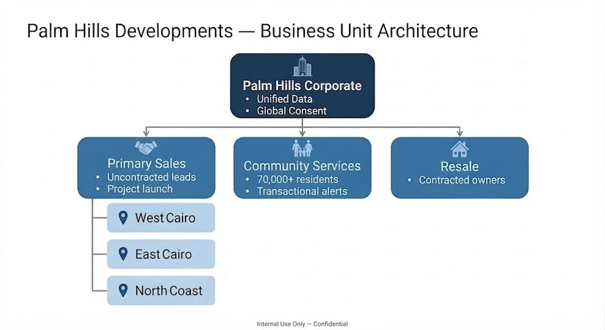
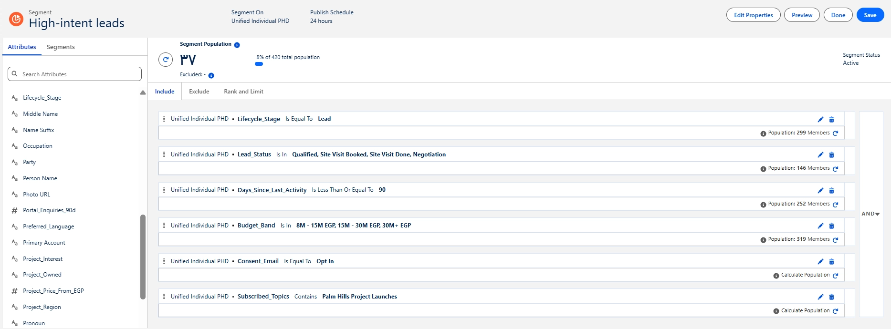
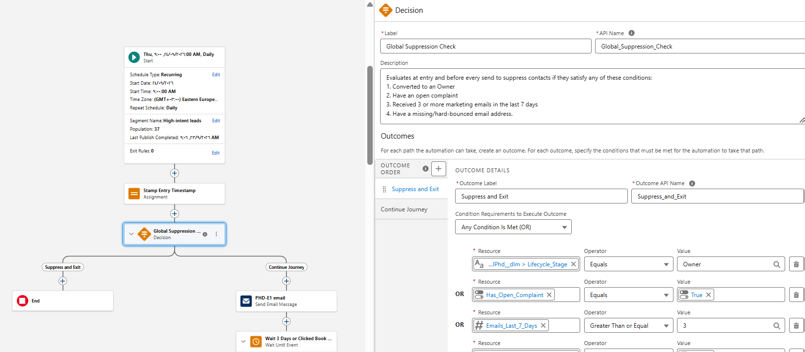
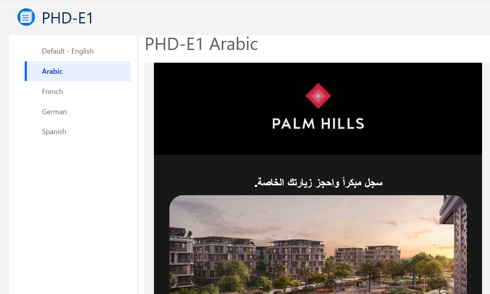
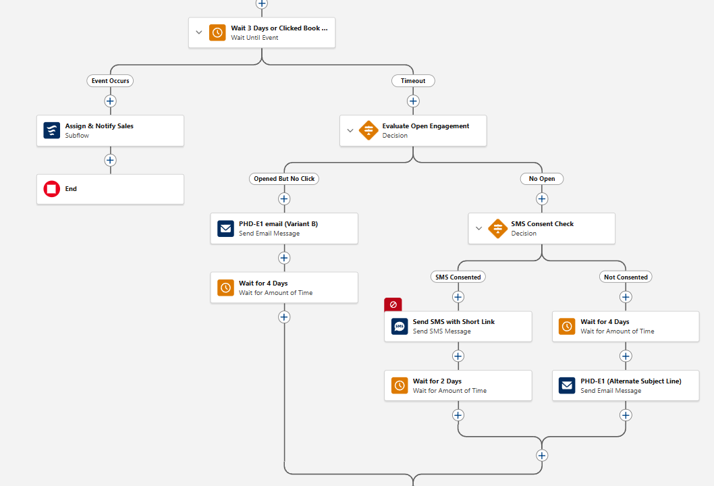
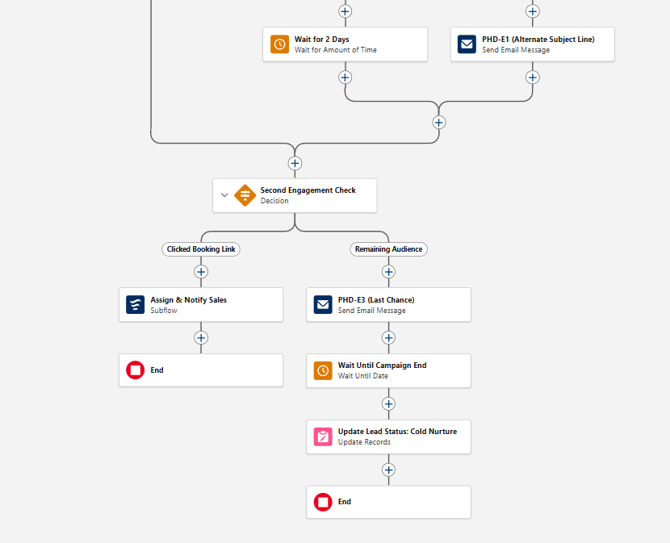
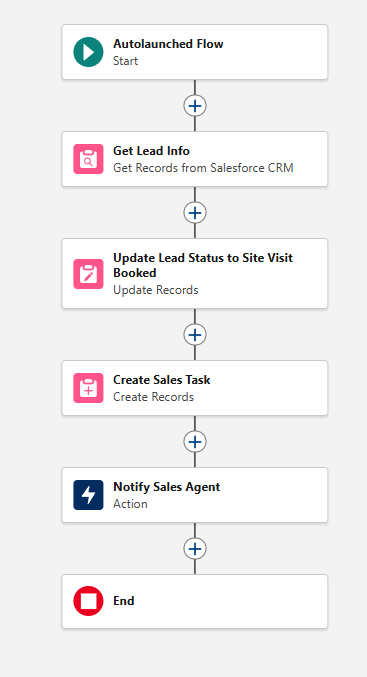
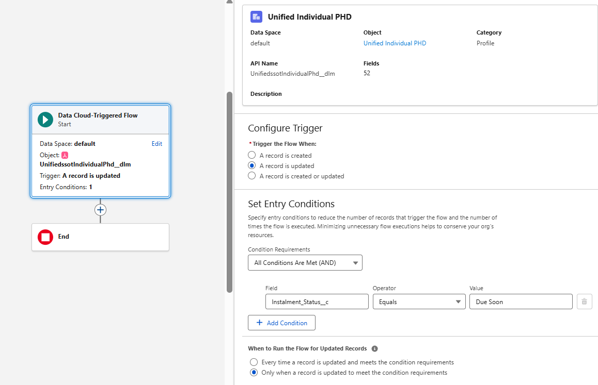
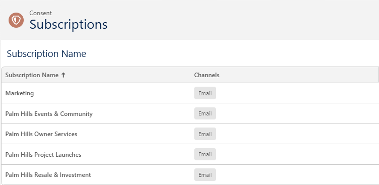
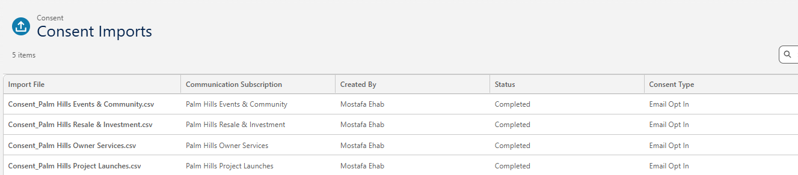

# 🎯 Project Overview


A **14-day, multi-channel lead nurture and cross-sell campaign** for the *Badya Second Release* (Palm Hills Developments, West Cairo), built end to end on **Marketing Cloud Next** and **Data 360**.

The brief asked for **120 booked site visits** from a list of **460 rows**. The build resolves that list to **420 unified individuals**, splits it into **three mutually exclusive audiences**, and orchestrates everything in **Salesforce Flow** with live consent and suppression checks before every send.

> [!NOTE]
> This is a **training exercise** completed during my Xperience 1st internship. Palm Hills is the example client, and all contact data is synthetic and intentionally not included in this repo.

<div align="center">
  
</div>

## 🧩 The Problem

Four months of paid social and portal lead generation filled the pipeline, but **volume is not conversion**. Without a structured nurture strategy:

- High-cost leads go cold
- Warm prospects receive irrelevant messages (e.g. first-time buyer emails reaching existing owners)
- Sales chases noise, and multiple agents can call the same lead

**Goal:** make the existing base work harder before any new paid spend is justified. Success is measured by **confirmed appointments**, not opens or clicks.

## 🧮 The Honest Math

<div align="center">

| | Count | Note |
|:---|:---:|:---|
| Source list rows | **460** | Raw import |
| Unified individuals | **420** | After identity resolution |
| 🎯 High-Intent Leads | **37** | Warm, uncontracted, in price band |
| 🏠 Owners worth a second unit | **24** | Current on installments, active in community app |
| 💤 Dormant Enquiries | **27** | Re-engagement only |
| ✅ Warm, reachable base | **61** | High-Intent + Owners, before consent filters |
| 🎯 Target | **120** | Booked site visits in 14 days |

</div>

> [!IMPORTANT]
> **No journey design closes a 61 vs 120 gap on its own.** The honest output of this build is maximum conversion of the 61, a clean suppression list, and a documented case for growing the qualified pipeline before the next release window. The gap is a **data reality that paid media must close**, not a build error.

## 🧱 Three Audiences, One List

All three segments are built on **`UnifiedIndividual`** and refresh daily at **09:00 Africa/Cairo**, so late opt-outs and mid-campaign conversions are enforced before the send window opens.

<div align="center">

| | 🎯 High-Intent Leads | 🏠 Owners (Second Unit) | 💤 Dormant Enquiries |
|---|:---:|:---:|:---:|
| **Size** | 37 | 24 | 27 |
| **Who** | Uncontracted, enquired, 8M+ EGP budget | Purchased in Badya, active in app | Uncontracted, gone quiet |
| **Key rule** | Last activity ≤ 90 days | App sessions (30d) ≥ 3, installments current | Last activity 91-365 days |
| **Lookback** | 90 days | 30 days | 1 year |
| **Subscription** | Project Launches | Resale & Investment | Project Launches |
| **First email** | `PHD-E1` shortlist | `PHD-E2` owner-only allocation | `PHD-E3` one question, one link |
| **Tone** | Direct, personal follow-up | Exclusive, early access | Low pressure |

</div>

<div align="center">
  
</div>

Full rules in [`docs/segment_logic.md`](docs/segment_logic.md).

## 🗺️ The Journey (High-Intent, 14 Days)

A **segment-triggered Flow**, refreshed and injected daily at 09:00. Every wait is anchored to **entry time**, never a calendar date, and a decision split re-checks consent and suppression **immediately before each send**.

```text
Entry (daily 09:00) → Stamp Entry Timestamp
→ Global Suppression Check ──(suppress)──→ END
→ PHD-E1 (Arabic or English by Preferred_Language)
→ Wait 3 days OR clicked "Book"
     ├─ Clicked  → Assign & Notify Sales (sub-flow) → END
     └─ Timeout  → Evaluate Open Engagement
          ├─ Opened, no click → PHD-E1 Variant B → wait 4 days
          └─ No open → SMS Consent Check
               ├─ Consented     → SMS + short link → wait 2 days
               └─ Not consented → wait 4 days → PHD-E1 alternate subject line
→ Second Engagement Check
     ├─ Clicked  → Assign & Notify Sales (same sub-flow) → END
     └─ Remaining → PHD-E3 (last chance) → wait until campaign end
                    → Update Lead Status: Cold Nurture → END
```

### 🛡️ Global Suppression Check
Runs at entry and before every send. A contact exits if **any** condition is true:
1. Converted to an Owner
2. Has an open complaint
3. Received 3 or more marketing emails in the last 7 days
4. Missing or hard-bounced email address

<div align="center">
  
</div>

This is what solves the **marketing overlap** problem: owners can never receive first-time buyer nurture, and nobody is over-messaged.

### 🌍 Language Routing
One journey, one timing, two routes. The email element uses **Locale = `Preferred_Language`**, so Arabic contacts get the Arabic variant of `PHD-E1` and everyone else (including blank) gets English.

<div align="center">
  
  
</div>

### 🔀 Engagement Branching

<div align="center">
  
</div>

<div align="center">
  
</div>

Details in [`docs/journey_design.md`](docs/journey_design.md).

## ♻️ Reusable Sub-Flow: Assign & Notify Sales

Both click paths (early click and second check) call the **same autolaunched sub-flow**, so handover logic is built once and maintained once.

<div align="center">
  
</div>

- Gets the Lead, updates **Lead Status → Site Visit Booked**
- Writes a **Campaign Member** status change
- Creates a **Task** on the owning sales team
- Sends an **internal notification** to the agent

> [!TIP]
> One owner per lead and one task per click event is what prevents several agents from calling the same lead.

## 🏠 Second Flow: Owner Service (Data Cloud-Triggered)

A separate **Data Cloud record-triggered Flow** on `UnifiedIndividual` that fires **only when `Instalment_Status` changes to `Due Soon`**.

<div align="center">
  
</div>

The one decision it must get right: **is this message promotional or transactional?**

<div align="center">

| | Promotional | Transactional |
|:---|:---:|:---:|
| **Example** | Second-unit offer | Instalment due reminder |
| **Needs active consent** | ✅ Yes | ❌ No |
| **Subscription** | Resale & Investment | Owner Services |

</div>

## ✅ Consent & Preference Centre

**No channel is used without a valid consent record.** Email is primary, SMS is the fallback where explicit SMS consent exists, and WhatsApp is reserved for owners active in the community app.

> [!WARNING]
> **Not Set is treated as no consent.** A blank or null consent never means "yes", and the journey suppresses that channel with no send and no fallback attempt.

<div align="center">

| Subscription | Channels |
|:---|:---:|
| Palm Hills Project Launches | Email, SMS, WhatsApp |
| Palm Hills Owner Services | Email, SMS |
| Palm Hills Resale & Investment | Email |
| Palm Hills Events & Community | Email, WhatsApp |

</div>

<div align="center">
  
  
</div>

Consent is stored as **individual consent records**, not a single boolean, and re-read at the moment of dispatch. Every Preference Centre toggle writes back to the live record, so a mid-journey opt-out is honoured on the **next node**. Full model in [`docs/consent_model.md`](docs/consent_model.md).

## 🔍 What the Data Cannot Prove

- **Small sample:** the journey ran on a directional sample, not a statistically significant population. Conversion rates cannot be generalised without a larger controlled test.
- **Score is not commitment:** an engagement score predicts intent, not booking.

## 🔁 What I Would Do Differently

- **Start with more volume.** A 61-person addressable pool cannot hit 120 visits, so the next build runs paid acquisition in parallel from day one.
- **Separate the Owner flow into its own journey earlier.** Mixing cross-sell and nurture logic in one canvas added suppression complexity that a dedicated flow would have avoided.

## 📁 Repository Structure

```text
├── README.md
└── docs/
    ├── segment_logic.md                  # Exact segment rules + Engagement Score
    ├── journey_design.md                 # Flow nodes, timing, branching, sub-flow
    ├── personalization.md                # Dynamic content, merge fields, AMPscript equivalents
    ├── consent_model.md                  # Subscriptions, channel rules, preference centre
    ├── client_discovery_questions.md     # 10 questions before a real build
    ├── Badya_Campaign_Build_Deck.pdf     # Full presentation
    └── *.png                             # Screenshots
```

## 🛠️ Tech Stack
**Marketing Cloud Next** · **Data 360** (Identity Resolution, Segments, Calculated Insights) · **Salesforce Flow** (Segment-triggered, Data Cloud-triggered, Autolaunched) · **Communication Subscriptions & Consent Imports** · **Email Locale Variants (Arabic / English)**
